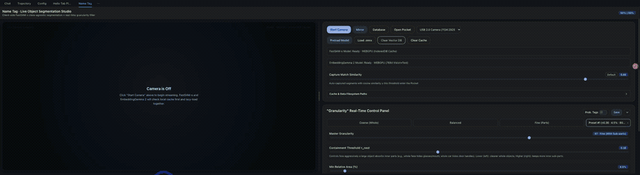
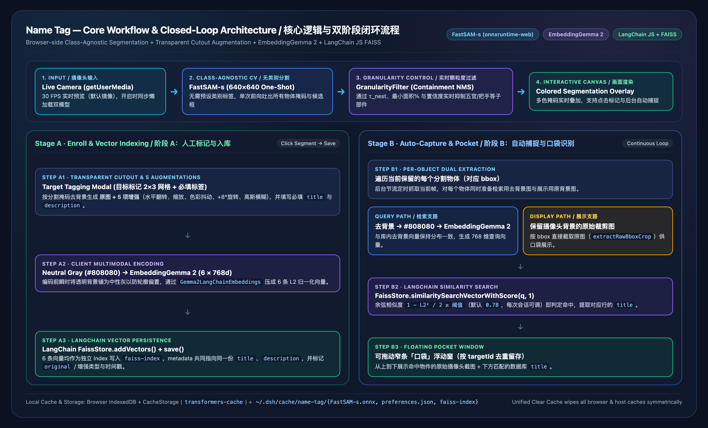
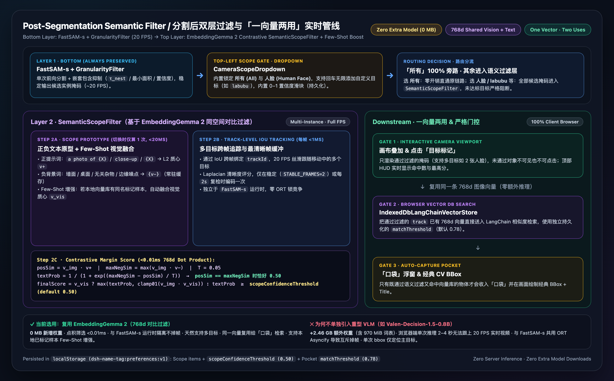

# Name Tag (`@deepseek-ai/dsh-client-name-tag`)

A dedicated, permanent **DeepSeek Harness (DSH) Web** plugin for **100% client-side AI** — **class-agnostic object segmentation, transparent cutout augmentation, multimodal embedding, preferences, and vector-database recognition all run and persist strictly inside each user's browser** (`WebGPU/WASM` + `IndexedDB` + `localStorage`). Even when DSH is deployed in the cloud for multiple concurrent users, the server executes zero AI inference and stores zero user data or vectors, ensuring complete multi-user isolation and privacy.

一个专为 **DeepSeek Harness (DSH) Web** 打造的永久集成插件，坚持 **100% 纯客户端 AI 架构**——**无类别物体分割、透明背景抠图增强、多模态向量编码、偏好预设以及向量数据库读写全部在用户各自的浏览器本地完成与存储**（`WebGPU/WASM` + `IndexedDB` + `localStorage`）。即使将 DSH 部署在云端供多用户同时访问，服务端也不运行任何 AI 推理、不保存任何用户数据或向量，天然保证多用户完全隔离与隐私安全。



---

## Table of Contents / 目录

| English | 中文 |
| :--- | :--- |
| [1. 📚 Latest Project Knowledge (`.wiki/`)](#en-wiki) | [1. 📚 使用 `.wiki/` 目录获取项目最新知识](#zh-wiki) |
| [2. Global Installation on DSH Web](#en-install) | [2. 在 DSH Web 上的全局安装（永久挂载）](#zh-install) |
| [3. Models & Frameworks (Design Rationale)](#en-models) | [3. 模型与框架选型说明（为什么这样选）](#zh-models) |
| [4. Core Workflow & Logic](#en-workflow) | [4. 核心逻辑与双阶段闭环流程](#zh-workflow) |
| [5. Post-Segmentation Semantic Filter & Trade-offs](#en-filter) | [5. 分割后的语义过滤层原理、实现与模型取舍](#zh-filter) |
| [6. UI Elements Reference](#en-ui) | [6. 界面各元素功能详解](#zh-ui) |

---

## English Documentation

<a id="en-wiki"></a>
### 1. 📚 Latest Project Knowledge (`.wiki/`)

To stay up to date with the latest architecture decisions, model contracts, development milestones, and debugging lessons without re-reading the entire codebase, consult the standalone **[`.wiki/`](./.wiki/index.md)** directory inside this project (maintained strictly under Andrej Karpathy's **LLM Wiki** pattern):

- **[`.wiki/index.md`](./.wiki/index.md)** — Content catalog of all requirements sources and maintained knowledge pages (start here).
- **[`.wiki/log.md`](./.wiki/log.md)** — Chronological append-only ledger of every feature, bug fix, and milestone.
- **[`.wiki/wiki/`](./.wiki/wiki/architecture.md)** — Maintained synthesis pages covering [Architecture](./.wiki/wiki/architecture.md), [FastSAM-s Lazy-Load](./.wiki/wiki/model-lazyload-and-fastsam.md), [Granularity Engine](./.wiki/wiki/granularity-engine.md), [Semantic Filtering & Trade-offs](./.wiki/wiki/semantic-filtering-and-tradeoffs.md), [UI & Design System](./.wiki/wiki/ui-and-design-system.md), [Roadmap](./.wiki/wiki/progress-and-roadmap.md), and [Troubleshooting](./.wiki/wiki/troubleshooting.md).
- **[`.wiki/raw/`](./.wiki/raw/001-project-inception-and-requirements.md)** — Immutable requirement snapshots.
- **[`.wiki/AGENTS.md`](./.wiki/AGENTS.md)** & **[`AGENTS.md`](./AGENTS.md)** — Wiki maintenance schema and project-wide OOP/verification coding rules.

---

<a id="en-install"></a>
### 2. Global Installation on DSH Web

`name-tag` is designed as a **permanent DSH Web profile plugin** (not a temporary `--patch` overlay). Its `package.json` declares `dsh.bundle.patch: "./cordis.patch.yml"` and `dsh.client.platform: "web"`, so once linked into the `web` profile, DSH Web automatically loads both its Node.js host routes and browser client bundle on every startup.

#### Step 1 — Build and test the plugin
```bash
cd /Users/xinyue.zhao/Desktop/dev/AI/DSH-Plugins/name-tag
pnpm install
pnpm run build
pnpm test
```

#### Step 2 — Permanently register into the DSH Web profile
```bash
cd /Users/xinyue.zhao/Desktop/dev/AI/deepseek-harness
pnpm dsh plugin --profile web add /Users/xinyue.zhao/Desktop/dev/AI/DSH-Plugins/name-tag
```
This registers `@deepseek-ai/dsh-client-name-tag` into `~/.dsh/profiles/web/package.json` (`dependencies` and `dsh.profile.bundles`) and activates its `cordis.patch.yml` (`id: ui-name-tag`).

#### Step 3 — Launch DSH Web normally
```bash
cd /Users/xinyue.zhao/Desktop/dev/AI/deepseek-harness
pnpm dsh web
```
Open `http://127.0.0.1:3080` in a WebGPU-capable browser (Chrome / Edge / Safari 26+ on macOS, Windows, or Android). The **Name Tag** tab appears at the far right of the conversation view tab bar.

> **Upgrade note**: After editing client-only files (`src/client/*`) and running `pnpm run build`, a browser hard refresh (`Cmd+Shift+R` / `Ctrl+F5`) loads the updated `lib/client.js`. Whenever Node host files (`src/index.ts`, `src/invariant.ts`, `src/vector-store.ts`) change, restart `pnpm dsh web`.

---

<a id="en-models"></a>
### 3. Models & Frameworks (Design Rationale)

| Layer | Technology | Role & Why Chosen |
| :--- | :--- | :--- |
| **CV Model** | **FastSAM-s** (`SpatialHub/fastsam-onnx`, ~47 MB ONNX) | **Class-agnostic one-shot instance segmentation**. Name Tag does not need the CV model to classify object categories—it only needs to detect *"this is an object"* and extract its segmentation mask/bbox in real time inside the browser. Unlike vanilla SAM (which requires hundreds of grid prompts per frame), FastSAM-s executes in a **single forward pass**, paired with **Containment NMS** (`GranularityFilter`) to prevent sub-part fragmentation (e.g., mouth/glasses inside a face or handles inside a car). |
| **CV Framework** | **`onnxruntime-web`** (WebGPU + WASM SIMD fallback) | Runs FastSAM-s locally inside the browser with zero server GPU cost, backed by local `/api/name-tag/ort/*` runtime hosting and 3-tier lazy-load caching (Browser IndexedDB → Host disk → HuggingFace). |
| **Embedding Model** | **EmbeddingGemma 2** (`onnx-community/embeddinggemma-2-ONNX`, `q4`) | Google DeepMind's natively multimodal embedding model (768-dim L2-normalized vector space). Configured with `audio_config = null` so only the Vision (170M) + Text (270M) encoders load in the browser, compressing segmented object cutouts into semantic index vectors. |
| **Embedding Runtime** | **`@huggingface/transformers` (Transformers.js v4)** | Runs EmbeddingGemma 2 in-browser (WebGPU primary, WASM fallback) and caches weights in Browser CacheStorage (`transformers-cache`), lazy-loaded in parallel with FastSAM-s upon starting the camera. |
| **LLM / Vector Framework & DB** | **LangChain JS** (`@langchain/core`) + **Browser IndexedDB (`IndexedDbLangChainVectorStore`)** | All embedding abstractions (`Embeddings`), metadata documents (`Document`), vector indexing (`addVectors`), and cosine similarity search (`similaritySearchVectorWithScore`) run **100% client-side in the user's browser** through a custom **LangChain JS `VectorStore`** subclass persisted in Browser **IndexedDB** (`dsh-name-tag-vectors`). Multi-user cloud deployments remain completely isolated with zero server-side user data. |

---

<a id="en-workflow"></a>
### 4. Core Workflow & Logic



The application forms a clean **two-stage closed loop** on top of live class-agnostic segmentation:
1. **Stage A — Enroll & Index**: Click any colored segment on the live camera feed to open **Target Tagging**. `CutoutAugmenter` removes the background via the segmentation mask to generate **1 original transparent cutout + 5 augmentations** (`Horizontal Flip`, `Scale Crop`, `Color Jitter`, `+8° Rotate`, `Gaussian Blur`). After entering required **Title** and **Description** and clicking **Save**, transparent areas are flattened onto neutral `#808080` gray right before encoding by **EmbeddingGemma 2** into 6 × 768-d vectors. **LangChain `IndexedDbLangChainVectorStore`** writes all 6 vectors into the user's browser IndexedDB (`dsh-name-tag-vectors`) as separate index entries whose metadata all point to the same `{ title, description }`, along with `original` / augmentation tags and timestamp.
2. **Stage B — Auto-Capture & Recognize**: While the camera runs and the database is non-empty, a throttled background loop extracts each segmented object (both a background-removed cutout for query embedding and a raw camera bbox crop keeping its original background for display), queries **LangChain `IndexedDbLangChainVectorStore.similaritySearchVectorWithScore`** in the browser, and whenever `cosineSimilarity = 1 - L2² / 2 ≥ threshold` (default `0.78`), pops up the draggable **Pocket** window displaying the raw camera crop and matched database `title`.

---

<a id="en-filter"></a>
### 5. Post-Segmentation Semantic Filter & Model Trade-offs



After **Layer 1 (`FastSAM-s` + `GranularityFilter`)** produces clean whole-object masks at ~20 FPS, Name Tag adds a real-time **Layer 2 (`SemanticScopeFilter`)** controlled by the top-left **`CameraScopeDropdown`** so users can focus exclusively on a chosen target (e.g., built-in **Human Face** or custom **labubu**) without losing real-time frame rate:

#### How the Filter Works Today (`src/client/core/SemanticScopeFilter.ts`)
1. **Zero-Overhead Bypass for `All`**: When **`All`** is selected (default), Layer 2 is completely bypassed—preserving 100% of the original behavior.
2. **Shared 768-d Vision + Text Contrastive Scoring**: Rather than loading another model, `SemanticScopeFilter` reuses the already-loaded **`EmbeddingGemma 2`** (`onnx-community/embeddinggemma-2-ONNX`) shared 768-d space:
   - On each scope switch (`< 20 ms`, once), positive prompts (`a photo of {target}`, `a close-up of {target}`, `{target}`) are averaged into a unit centroid $v_+$, paired with cached generic background/distractor vectors $\{v_-\}$.
   - Because raw cross-modal cosine similarity lies in a narrow band (`~0.15–0.35`), each segment's image vector $v_{\text{img}}$ is scored by a temperature-scaled margin logistic function ($T = 0.05$): $\text{textProb} = 1 / (1 + \exp((\max_k(v_{\text{img}} \cdot v_{-,k}) - v_{\text{img}} \cdot v_+) / T))$, so an even margin maps cleanly to **`0.50`** on the dropdown's `0.00–1.00` slider.
   - **Few-Shot Visual Fusion**: If the user has already tagged a matching title in their browser IndexedDB vector store (`BrowserTargetVectorRepository.getVectorsByTitle`), its visual centroid $v_{\text{vis}}$ is fused automatically via $\max(\text{textProb}, \text{clamp}_{0..1}(v_{\text{img}} \cdot v_{\text{vis}}))$—greatly boosting niche or IP targets like `labubu`.
3. **Multi-Instance IoU Tracking & One-Vector-Two-Uses**: Every live FastSAM-s mask is tracked across frames via IoU (`STABLE_FRAMES = 2`, `REQUERY_MS = 2000`, sharpest crop selected by Laplacian variance) so multiple matching instances (e.g., 2 faces) track smoothly at 20 FPS. For every track that passes `score ≥ scopeConfidenceThreshold`, **the exact same 768-d `v_img` vector is forwarded directly to the Pocket vector DB search**—zero duplicate embedding inference. Unmatched objects are strictly blocked from canvas overlay, click-to-tag, and the Pocket.

#### Why Not a Standalone Model Like Valen ([`Valen-Team/valen-sdk-js`](https://github.com/Valen-Team/valen-sdk-js))?
We evaluated and prototyped running a dedicated client-side multimodal decision/grounding model—specifically **[Valen (`Valen-Team/valen-sdk-js`)](https://github.com/Valen-Team/valen-sdk-js)** (`Valen-Decision-1.5-0.8B-ONNX`, `web-portable` variant with [`#bbox-questions`](https://github.com/Valen-Team/valen-sdk-js#bbox-questions))—as the post-segmentation filter, and deliberately chose **`EmbeddingGemma 2` reuse** for real-time camera filtering:

| Trade-off | Reusing `EmbeddingGemma 2` (`SemanticScopeFilter`) | Standalone 0.8B VLM ([`valen-sdk-js`](https://github.com/Valen-Team/valen-sdk-js)) |
| :--- | :--- | :--- |
| **Real-Time Latency** | **< 0.01 ms** dot-product per track (reuses Pocket embedding; full ~20 FPS camera) | **~2–4 s per call** on browser WebGPU—designed for System-1 reasoning, too slow for 20 FPS live gating |
| **Model Footprint** | **0 MB extra** (reuses already-cached `EmbeddingGemma 2`) | **+2.46 GB** extra browser weights (including a 970 MiB FP32 embedding table) |
| **Runtime Contention** | Isolated in `transformers.web.js` runtime—**zero FPS stall on `FastSAM-s`** | Shares `onnxruntime-web`'s single Emscripten Asyncify WebGPU/WASM stack with `FastSAM-s`, requiring mutual exclusion that stalls live segmentation |
| **Multi-Instance** | **Native** (keeps all matching faces/objects in frame simultaneously) | Single primary `bbox` per question call |
| **Custom / Niche IPs** | Zero-shot text + **automatic few-shot boost** once tagged in Vector DB | Strong open-world VLM reasoning, best suited to offline or low-frequency decision tasks |

> Full architectural decision record (ADR) & comparison with ultra-light specialized detectors (BlazeFace / YOLO-World) are documented in [`.wiki/wiki/semantic-filtering-and-tradeoffs.md`](./.wiki/wiki/semantic-filtering-and-tradeoffs.md).

---

<a id="en-ui"></a>
### 6. UI Elements Reference

#### A. Top Bar & Split-Screen Layout
- **`Name Tag` Tab**: Mounted at the far right of DSH Web's `conversation.view` tab strip (`order: 999`).
- **Workspace Header**: Displays the studio title and a top-right **Expand / Collapse Fullscreen** icon button. In fullscreen mode, a persistent semi-transparent top-center toast reminds the user to press `ESC` to exit (clicking the collapse button also exits).
- **Center Divider Handle (`SplitPaneDivider`)**: Drag horizontally to resize camera viewport vs. control panel (`26% ~ 74%`); double-click to reset `50 / 50`.

#### B. Left Pane — Live Camera Viewport (`CameraViewport`)
- **Video + High-DPI Segmentation Canvas**: Live camera stream (mirrored by default) overlaid with colored instance segmentation masks and crisp contours. Hovering highlights a segment; clicking opens **Target Tagging**. Once an object is recognized against the FAISS vector store, a classic CV **bounding box + `title` tag** is drawn directly around it (unaffected by the `Prob. Tags` switch).
- **Top-Left Editable Scope Dropdown (`CameraScopeDropdown`)**: Anchored at the top-left of the camera frame with two locked built-in options (**`All`** and **`Human Face`**) plus unbounded user-added targets (press `Enter` continuously to add; custom items support inline `✎` rename and `×` delete). Includes an internal **`Filter Confidence`** slider (`0.00 ~ 1.00`, default **`0.50`**, persisted in `localStorage`) directly beneath the input, plus a warm golden-amber non-dismissible **Tips bubble** (appears for 5s on every camera start and repeats every 60s).
- **HUD Chips**: Shows viewport label, active semantic scope filter status chip (matched count & peak score when non-`All`), FastSAM-s status, click-to-tag hint, live resolution, and detection FPS.

#### C. Right Pane — Card 1: Camera, Models & Matching (`CameraControlStrip`)
- **Primary Action Row**:
  - **`Start Camera` / `Stop Camera`**: Controls webcam streaming and simultaneously triggers lazy-loading for both `FastSAM-s` and `EmbeddingGemma 2`.
  - **`Mirror`**: Toggles horizontal camera mirroring (**ON by default**).
  - **`Database`**: Opens the 5-column **Vector Database Contents** modal (`index` showing first 5 `...` last 5 floats, full `augmentation`, resizable `title` & `description` columns, clickable `timestamp` sorted `DESC` by default).
  - **`Open Pocket`**: Opens the draggable **Pocket** floating window manually (even when empty).
- **Camera Selector**: Switches between available video input devices.
- **Model & Cache Row**:
  - **`Preload Model`**: Checks local caches and preloads both models; shows a **`❗️` alert badge** on the top-right corner when no local `FastSAM-s` cache exists.
  - **`Load .onnx`**: Manually imports a local `.onnx` FastSAM model file.
  - **`Clear Vector DB`**: Clears **only** the browser-local IndexedDB vector database (`dsh-name-tag-vectors`), preserving cached CV/embedding models and granularity presets.
  - **`Clear Cache`**: Wipes `FastSAM-s` IndexedDB cache, `EmbeddingGemma 2` Browser Cache (`transformers-cache`), saved granularity presets/preferences (`localStorage`), the browser vector database (`dsh-name-tag-vectors`), and the Pocket.
- **Dual Model Status Banners**: Real-time lazy-load progress bars and execution backend badges (`WebGPU` / `WASM`) for both **FastSAM-s** and **EmbeddingGemma 2**.
- **`Capture Match Similarity` Slider**: Controls Pocket vector DB cosine similarity (`0.00 ~ 1.00`, **default `0.78`**, persisted in `localStorage` independently from the dropdown's `Filter Confidence` slider and reset on `Clear Cache`) with a **`Default`** reset button.
- **`Client-Side Local Storage & Caches` (Collapsible, default closed)**: Expands to display the browser vector DB (`IndexedDB dsh-name-tag-vectors` + target/vector counts), `localStorage` preferences key, browser model caches, and the optional read-only Host model mirror path.

#### D. Right Pane — Card 2: `"Granularity" Real-Time Control Panel` (`GranularityCard`)
- **Header Actions**: **`Prob. Tags`** switch (session-only, default `OFF`, toggles `#idx · score` pills on camera overlay), **`Save`** button (saves current parameters as a preset), and **Collapse Chevron** (persisted).
- **Quick Presets + Saved Dropdown**: `Coarse (Whole)` / `Balanced` / `Fine (Parts)` chips, plus a conditional **Saved Presets Dropdown** (hidden when empty; each item supports inline text editing without changing selection state, a green/gray **Check (`✓`)** button to apply, and an instant **`×`** delete button).
- **Sliders**: `Master Granularity (0..100)`, `Containment Threshold τ_nest (0..1)`, `Min Relative Area (0%..100%)`, and `Objectness Confidence (0%..100%)`.
- **`Show suppressed sub-part masks` Switch** + **5 Live Stats** (`Kept Masks`, `Suppressed`, `Filter Time`, `Inference`, `Detect FPS`).

#### E. Modals & Floating Pocket
- **`Target Tagging` Modal (`TargetTagModal`)**: Left **2×3** transparent cutout + augmentations grid; right required **`Title *`** & **`Description *`** inputs + **`Save`** button.
- **`Vector Database Contents` Modal (`VectorDbModal`)**: 5-column FAISS inspector with draggable right borders on `title` & `description` and clickable `timestamp` sort.
- **`Pocket` Floating Window (`PocketFloatingWindow`)**: High-contrast draggable narrow floating strip stacking matched raw camera crops (keeping camera background) + matched database `title` top-to-bottom.

---

## 中文文档

<a id="zh-wiki"></a>
### 1. 📚 使用 `.wiki/` 目录获取项目最新知识

如果您或后续开发 Agent 需要快速掌握本项目的最新架构演进、模型契约、开发进度与历史排错经验，无需重新通读全部源码，直接查阅项目根目录下的独立知识库 **[`.wiki/`](./.wiki/index.md)** 即可（严格按照 Andrej Karpathy 的 **LLM Wiki** 范式持续维护）：

- **[`.wiki/index.md`](./.wiki/index.md)** —— 知识库总目录，按类别索引全部文档与一句话摘要（建议首选阅读）。
- **[`.wiki/log.md`](./.wiki/log.md)** —— 按时间顺序追加的演进日志，记录每次构建、功能增量、架构决策与修复详情。
- **[`.wiki/wiki/`](./.wiki/wiki/architecture.md)** —— 持续维护的专题知识页，涵盖 [系统架构](./.wiki/wiki/architecture.md)、[FastSAM-s 懒加载契约](./.wiki/wiki/model-lazyload-and-fastsam.md)、[颗粒度引擎](./.wiki/wiki/granularity-engine.md)、[语义过滤层与模型取舍](./.wiki/wiki/semantic-filtering-and-tradeoffs.md)、[UI 与设计规范](./.wiki/wiki/ui-and-design-system.md)、[进度与路线图](./.wiki/wiki/progress-and-roadmap.md) 以及 [常见故障排查](./.wiki/wiki/troubleshooting.md)。
- **[`.wiki/raw/`](./.wiki/raw/001-project-inception-and-requirements.md)** —— 不可变的原始需求与决策快照。
- **[`.wiki/AGENTS.md`](./.wiki/AGENTS.md)** 与 **[`AGENTS.md`](./AGENTS.md)** —— Wiki 维护规范以及项目级 OOP / 测试门禁开发准则。

---

<a id="zh-install"></a>
### 2. 在 DSH Web 上的全局安装（永久挂载）

`name-tag` 是专为 **DSH Web 端永久集成**设计的插件（非临时 `--patch` 调试模式）。项目通过 `package.json` 的 `dsh.bundle.patch: "./cordis.patch.yml"` 与 `dsh.client.platform: "web"` 声明双面能力，挂载后每次正常启动 `dsh web` 都会自动加载。

#### 第一步：构建并运行单元测试
```bash
cd /Users/xinyue.zhao/Desktop/dev/AI/DSH-Plugins/name-tag
pnpm install
pnpm run build
pnpm test
```

#### 第二步：全局注册到 DSH Web Profile
```bash
cd /Users/xinyue.zhao/Desktop/dev/AI/deepseek-harness
pnpm dsh plugin --profile web add /Users/xinyue.zhao/Desktop/dev/AI/DSH-Plugins/name-tag
```
该命令会自动将 `@deepseek-ai/dsh-client-name-tag` 写入 `~/.dsh/profiles/web/package.json`（包含 `dependencies` 与 `dsh.profile.bundles`），并自动启用 `cordis.patch.yml`（`id: ui-name-tag`）。

#### 第三步：正常启动 DSH Web
```bash
cd /Users/xinyue.zhao/Desktop/dev/AI/deepseek-harness
pnpm dsh web
```
在支持 WebGPU 的浏览器（macOS / Windows / Android 的 Chrome、Edge 或 Safari 26+）访问 `http://127.0.0.1:3080`，会话选项卡最末尾即可看到 **Name Tag**。

> **更新说明**：仅修改前端代码（`src/client/*`）并执行 `pnpm run build` 后，浏览器强刷（`Cmd+Shift+R` / `Ctrl+F5`）即可生效；若修改了宿主机代码（`src/index.ts`、`src/invariant.ts`、`src/vector-store.ts`），需重启一次 `pnpm dsh web`。

---

<a id="zh-models"></a>
### 3. 模型与框架选型说明（为什么这样选）

| 层级 | 选用方案 | 职责与选型原因 |
| :--- | :--- | :--- |
| **CV 分割模型** | **FastSAM-s**（`SpatialHub/fastsam-onnx`，~47 MB ONNX） | **无类别单次前向实例分割**。Name Tag 不依赖检测器去判断“这是什么类别”，只需要在浏览器端实时确定“这是一个完整物件”并拿到它的分割掩码与 bbox，语义识别交由后续 Embedding + 向量检索承担。相比原生 SAM 每帧需铺数百个网格点提示，FastSAM-s 只需**单次前向推理**即可输出全部候选实例，并配合 **Containment NMS**（`GranularityFilter`）避免切分出五官、车门把手等零碎子部件。 |
| **CV 推理框架** | **`onnxruntime-web`**（WebGPU 优先 + WASM SIMD 兜底） | 在浏览器客户端直接运行 FastSAM-s，零服务端 GPU 开销；插件 Node 宿主机本地托管 `/api/name-tag/ort/*` 运行时资产，并通过三级本地优先懒加载（浏览器 IndexedDB → 宿主机磁盘缓存 → HuggingFace）加速加载。 |
| **嵌入模型** | **EmbeddingGemma 2**（`onnx-community/embeddinggemma-2-ONNX`，`q4` 量化） | Google DeepMind 开源原生多模态嵌入模型（统一 768 维 L2 归一化空间）。初始化时显式置空音频编码器（`audio_config = null`），仅加载视觉（170M）+ 文本（270M）编码器，把裁剪后的物体图片压缩为高区分度向量索引。 |
| **嵌入推理框架** | **`@huggingface/transformers`（Transformers.js v4）** | 在浏览器端直接运行 EmbeddingGemma 2，权重缓存在浏览器 CacheStorage（`transformers-cache`），并在开启摄像头时与 FastSAM-s 同步触发懒加载。 |
| **LLM 框架与向量库** | **LangChain JS**（`@langchain/core`）+ **浏览器 IndexedDB（`IndexedDbLangChainVectorStore`）** | 所有嵌入抽象（`Embeddings`）、文档实体（`Document`）、向量写入（`addVectors`）与余弦相似度检索（`similaritySearchVectorWithScore`）**100% 在各自用户浏览器本地运行**，通过继承 LangChain `VectorStore` 并持久化到浏览器 **IndexedDB**（`dsh-name-tag-vectors`）实现。云端多用户访问天然绝对隔离，服务端不存任何业务向量与偏好。 |

---

<a id="zh-workflow"></a>
### 4. 核心逻辑与双阶段闭环流程


整个系统围绕实时的无类别物体分割构建了两段闭环：
1. **阶段 A（物体标记与增强入库）**：在实时摄像头画面上点击任意分割块，弹出 **「目标标记」** 对话框。系统按分割掩码去除背景生成 **1 张透明原图 + 5 张经典增强图**（水平翻转、尺度缩放、色彩抖动、`+8°` 旋转、高斯模糊）。填写必填的 **「标题」** 与 **「介绍」** 并点击 **「保存」** 后，透明底会瞬时铺平为 `#808080` 中性灰送入 **EmbeddingGemma 2** 压成 6 条 768 维向量，再由 **LangChain `IndexedDbLangChainVectorStore`** 作为 6 条独立索引存入当前用户浏览器的 **IndexedDB（`dsh-name-tag-vectors`）**——它们共同指向同一份 `{ title, description }` 元数据，同时记录各自是 `original` 还是具体某种 `augmentation` 及存入时间戳。
2. **阶段 B（自动连续捕捉与口袋识别）**：当摄像头开启且数据库非空时，后台按节流周期自动截取当前保留的每个分割物体（对应 bbox）：内部以去背景抠图生成查询向量直接在浏览器内通过 **LangChain `IndexedDbLangChainVectorStore.similaritySearchVectorWithScore`** 检索最接近的索引；一旦余弦相似度（`1 - L2² / 2`）达到或超过设定阈值（默认 `0.78`，每次会话可调），即刻弹出可拖动的 **「口袋」** 窄条浮动窗，按 `targetId` 去重展示该物体的原始摄像头截图（保留背景）及匹配到的数据库 `title`。

---

<a id="zh-filter"></a>
### 5. 分割后的语义过滤层原理、实现与模型取舍


在 **底层（Layer 1：`FastSAM-s` + `GranularityFilter`）** 以约 20 FPS 稳定产出整物分割掩码的基础上，Name Tag 在其上方叠加了一层实时 **语义过滤层（Layer 2：`SemanticScopeFilter`）**，由镜头左上角的 **`CameraScopeDropdown`** 控制，实现“只保留你当前关心的目标（如内置的 **人脸** 或自定义的 **labubu**）”且不拖慢实时帧率：

#### 当前原理与实现（`src/client/core/SemanticScopeFilter.ts`）
1. **「所有 / All」零开销旁路**：默认选中 **「所有」** 时，直接 100% 跳过语义过滤层，与原有全量分割/捕捉行为完全一致。
2. **复用 `EmbeddingGemma 2` 768 维图文同空间对比打分**：不引入任何额外模型，直接复用浏览器里已加载好的 **`EmbeddingGemma 2`**（Vision + Text 统一 768 维归一化空间）：
   - 每次切换非「所有」选项时（仅算 1 次，`< 20 ms`），将正提示词模板（`a photo of {目标}`、`a close-up of {目标}`、`{目标}`）编码并 L2 平均为正质心 $v_+$，配合常驻内存的通用背景/杂物负提示词向量集合 $\{v_-\}$。
   - 由于图-文跨模态裸余弦值通常集中在较窄区间（`~0.15–0.35`），系统使用带温度系数（$T = 0.05$）的正负间隔逻辑斯蒂函数将其映射到直观的 `0.00 ~ 1.00` 概率分：$\text{textProb} = 1 / (1 + \exp((\max_k(v_{\text{img}} \cdot v_{-,k}) - v_{\text{img}} \cdot v_+) / T))$——当正负相似度打平时恰好输出 **`0.50`**，与下拉框默认阈值完美契合。
   - **Few-Shot 视觉原型自动融合**：如果用户已在本地向量库中标记过同名目标（`BrowserTargetVectorRepository.getVectorsByTitle`），过滤层会自动把这些视觉样本质心 $v_{\text{vis}}$ 融合进来（$\max(\text{textProb}, \text{clamp}_{0..1}(v_{\text{img}} \cdot v_{\text{vis}}))$），显著提升像 `labubu` 这类小众潮玩/特定 IP 的筛选准度。
3. **多目标跨帧 IoU 追踪与「一向量两用」**：`SemanticScopeFilter` 为每个实时分割块维护 `trackId`（`STABLE_FRAMES = 2`、每 `2s` 复检，并用 Laplacian 方差缓冲最清晰抠图），移动中的多个同类目标（如多张人脸）都能以 20 FPS 平滑跟随。通过 `score ≥ scopeConfidenceThreshold` 过滤的物体，**直接把同一条 768 维图像向量送入下游「口袋」向量库检索**，实现零重复编码；未通过的目标被严格拦截，不会渲染到画布、不可点击标记、也不会进入「口袋」。

#### 为什么不单独引入其他模型（如 [Valen (`Valen-Team/valen-sdk-js`)](https://github.com/Valen-Team/valen-sdk-js)）？
在方案演进过程中，我们实测接入并评估过纯端侧多模态决策模型 **[Valen（`Valen-Team/valen-sdk-js`）](https://github.com/Valen-Team/valen-sdk-js)**（`Valen-Decision-1.5-0.8B-ONNX` `web-portable` 变体及其 [`#bbox-questions`](https://github.com/Valen-Team/valen-sdk-js#bbox-questions) 定位能力），最终放弃单独运行重型 VLM、选择**复用 `EmbeddingGemma 2`**，核心工程取舍如下：

| 评估维度 | 当前方案：复用 `EmbeddingGemma 2`（`SemanticScopeFilter`） | 单独引入重型 VLM（如 [`valen-sdk-js`](https://github.com/Valen-Team/valen-sdk-js) 0.8B `bbox`） |
| :--- | :--- | :--- |
| **实时性 / 延迟** | 768 维点积耗时 **`< 0.01 ms`**（复用口袋向量，摄像头保持 ~20 FPS 满帧） | 浏览器 WebGPU 单次推理需 **2–4 秒**，本质是 System-1 慢决策模型，跟不上实时视频流 |
| **额外模型体积** | **0 MB**（直接复用已缓存的 `EmbeddingGemma 2`） | **+2.46 GB** 额外下载与显存/内存开销（仅 FP32 词表就占 970 MiB） |
| **与 FastSAM-s 并发隔离** | 运行在 `transformers.web.js` 独立运行时中，**不与 `FastSAM-s` 抢锁掉帧** | 与 `FastSAM-s` 共用 `onnxruntime-web` 单一 Emscripten Asyncify 栈，必须全局互斥串行，直接拖垮分割帧率 |
| **多目标支持** | **原生支持多目标**（同屏多张人脸 / 多个自定义物件全部保留） | 单次 `bbox` 问答默认仅定位单个主目标 |
| **小众物体与扩展性** | 文本零样本 + **本地标记一次即自动触发 Few-Shot 视觉增强** | 开放世界推理强，但更适合低频/离线决策，而非高频视频门控 |

> 完整架构决策记录（ADR）以及与超轻量专用检测器（BlazeFace / YOLO-World）的进一步对比，已归档在项目知识库 [`.wiki/wiki/semantic-filtering-and-tradeoffs.md`](./.wiki/wiki/semantic-filtering-and-tradeoffs.md)。

---

<a id="zh-ui"></a>
### 6. 界面各元素功能详解

#### A. 顶部导航与左右分栏布局
- **`Name Tag` 选项卡**：固定位于 DSH Web 会话顶部选项卡的最右侧（`order: 999`）。
- **工作台顶栏**：展示应用标题与右上角 **全屏展开 / 退出全屏** 图标按钮；进入全屏后顶部居中会长时间漂浮一个半透明 Toast 提示「按 ESC 退出全屏」（按 `ESC` 或再次点击收起按钮均可退出）。
- **中间分栏拖动把手（`SplitPaneDivider`）**：支持左右横向拖拽调节摄像头区域与右侧功能区宽度（`26% ~ 74%`），双击重置为 `50 / 50`。

#### B. 左侧视窗 — 实时摄像头区域（`CameraViewport`）
- **实时视频 + 高 DPI 分割叠加层**：实时渲染摄像头画面（默认开启镜像），并覆盖多色实例分割掩码与轮廓线；鼠标悬停会高亮对应块，点击即弹出「目标标记」弹窗。一旦物体在 FAISS 向量库中被认出，画面上会同步在其周围绘制经典的 CV **矩形边界框 + `title` 标题标签**（不受「概率标签」开关影响）。
- **左上方可编辑类别筛选下拉框（`CameraScopeDropdown`）**：内置两个不可编辑、不可删除的固定项 **「所有」** 与 **「人脸」**，支持在输入框中连续输入并按 `Enter` 无限添加自定义目标（自定义项支持行内 `✎` 重命名与 `×` 删除）；输入框正下方内置 **「筛选置信度阈值」** 滑块（`0.00 ~ 1.00`，默认 **`0.50`**，持久化于 `localStorage`）；每次开启摄像头时左上方会弹出 5 秒不可主动关闭的暖金渐变 **Tips 气泡**，并每 1 分钟自动重弹一次。
- **顶部悬浮 HUD 胶囊**：展示视窗名称、当前语义筛选状态芯片（非「所有」时实时显示命中数与最高分）、模型状态、点击标记提示、实时分辨率与检测 FPS。

#### C. 右侧功能区 — 第一张卡：摄像头、模型与匹配控制卡（`CameraControlStrip`）
- **主操作按钮行**：
  - **「开启摄像头 / 停止摄像头」**：控制摄像头启停，并在开启时同步懒加载 `FastSAM-s` 与 `EmbeddingGemma 2`。
  - **「镜像」**：切换画面左右镜像（**默认开启**）。
  - **「数据库」**：打开 **5 列表格弹窗**查看 FAISS 向量库（`index` 显示前 5 位 `...` 后 5 位、`augmentation` 全文、可横向拖拽调节列宽的 `title` 与 `description` 全文、可点击切换升降序且默认 `DESC` 的 `timestamp` 列）。
  - **「打开口袋」**：手动打开可拖动的「口袋」浮动窗（即使暂未命中任何物体也可打开）。
- **摄像头设备下拉选择**：在多摄像头环境下切换输入设备。
- **模型与缓存控制行**：
  - **「预加载模型」**：检查本地缓存并预加载双模型；当本地未发现 `FastSAM-s` 模型时，按钮右上角显示 **`❗️` 提醒角标**。
  - **「导入 .onnx」**：支持手动选择本地 `.onnx` 模型文件加载。
  - **「清空向量库」**：**仅清空**当前浏览器的 IndexedDB 向量数据库（`dsh-name-tag-vectors`），保留已缓存的模型权重与颗粒度预设。
  - **「清缓存」**：一键清空 `FastSAM-s` IndexedDB 缓存、`EmbeddingGemma 2` 浏览器缓存（`transformers-cache`）、颗粒度参数与已保存预设（`localStorage`）、浏览器向量库（`dsh-name-tag-vectors`）以及口袋内容。
- **双模型状态与进度条**：分别展示 `FastSAM-s` 与 `EmbeddingGemma 2` 的加载状态及执行后端（`WebGPU` / `WASM`）。
- **「捕捉匹配相似度阈值」滑块**：专用于「口袋」功能的向量库余弦相似度阈值（范围 `0.00 ~ 1.00`，**默认 `0.78`**，与下拉框内的「筛选置信度阈值」相互独立，均持久化于 `localStorage` 并在「清缓存」时重置），右侧配有 **「默认」** 快捷重置按钮。
- **「客户端本地存储与缓存位置」折叠子块（默认关闭）**：点击可展开查看浏览器向量库（`IndexedDB dsh-name-tag-vectors` 及目标/向量数统计）、`localStorage` 偏好键名、浏览器模型缓存，以及宿主机只读公共模型镜像路径（无任何用户数据）。

#### D. 右侧功能区 — 第二张卡：「“颗粒度”实时调控面板」（`GranularityCard`）
- **卡片右上角操作区**（从左到右）：
  - **「概率标签」Switch**：会话级临时开关（默认关闭、不随预设保存），控制是否在摄像头分割块上显示 `#编号 · 置信度` 标签。
  - **「保存」按钮**：将当前滑块参数保存为一条自定义预设。
  - **折叠按钮**：折叠或展开面板主体（折叠状态持久化）。
- **快速预设 + 条件式已保存下拉框**：
  - **「偏粗 (整物优先)」「均衡 (常规物体)」「偏细 (含小件/部分零件)」** 快速预设按钮。
  - **已保存预设下拉框**（无任何保存项时不显示，有保存项时紧邻「偏细」按钮出现）：每条记录支持**点击文字行内重命名**（不改变选中状态）、中间配有**绿色（已选）/ 灰色（未选）Check 勾选按钮**切换应用，右侧配有**即点即删的 `×` 按钮**（无需确认）。
- **四组调控滑块**：`综合颗粒度 (0 ~ 100)`、`嵌套包含阈值 τ_nest (0 ~ 1)`、`最小相对面积占比 (0% ~ 100%)`、`置信度阈值 Objectness (0% ~ 100%)`。
- **「显示被抑制的子部件掩码」开关** + **5 项实时统计指标**（保留分割数、已抑制子块、过滤耗时、推理耗时、实时帧率）。

#### E. 弹窗与浮动口袋
- **「目标标记」模态框（`TargetTagModal`）**：左栏 **2×3** 透明背景原图与 5 项增强预览，右栏必填 **「标题 *」** 与 **「介绍 *」** 输入框，点 **「保存」** 编码入库。
- **「向量数据库内容」模态框（`VectorDbModal`）**：5 列展示 FAISS 索引与元数据，支持拖拽 `title` / `description` 右边界调宽与点击 `timestamp` 排序。
- **「口袋」浮动窗口（`PocketFloatingWindow`）**：高对比度主色顶栏、可全屏拖动的窄条浮动窗，从上到下展示命中物件的原始摄像头截图（保留背景）及下方对应的数据库 `title`。
